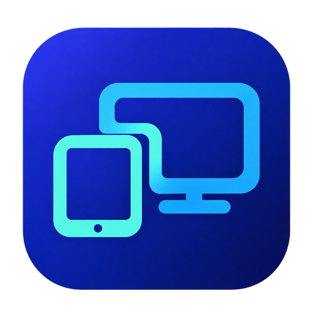
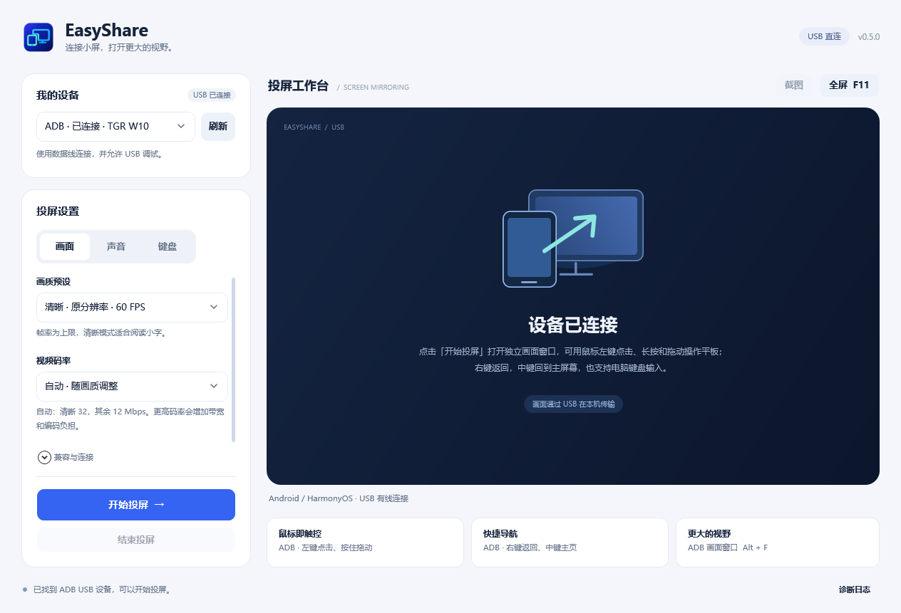

<p align="center">
  
</p>

<h1 align="center">EasyShare</h1>

<p align="center">把 Android / HarmonyOS 设备的画面，通过 USB 带到 Windows。</p>
<p align="center">0.5.0 · Windows 10 / 11 x64 · 中文界面</p>

<p align="center">
  <a href="https://github.com/Shioyo/EasyShare/releases">下载 Releases</a> ·
  <a href="#快速开始">快速开始</a> ·
  <a href="#兼容范围">兼容范围</a> ·
  <a href="#电脑键盘输入中文">中文输入</a> ·
  <a href="docs/BUILD.md">源码构建</a>
</p>



[EasyShare](https://github.com/Shioyo/EasyShare) 将 USB 设备发现、画质、声音和输入设置集中在一个 Windows 桌面界面。0.5.0 更新应用图标与界面，将设置整理为 **画面 / 声音 / 键盘** 三个页签。ADB 设备使用官方 scrcpy 显示独立投屏窗口；HDC 设备使用 HOScrcpy 与内嵌播放器。程序按设备实际提供的调试接口选择连接方式。

## 功能

- **USB 连接**：自动发现 ADB / HDC 设备，显示待授权、离线和就绪状态；每 5 秒后台更新设备列表。
- **画质与码率**：流畅、清晰、轻量三档，视频目标码率可单独选择，清晰档请求原始分辨率。
- **声音传到电脑**：ADB 路径支持系统音频、独立声音开关与 Opus 音频码率选择。
- **鼠标操作**：在 ADB 画面中点击、拖动，通过右键返回、中键回到主屏幕。
- **平板输入法**：电脑键盘发送拼音按键，由平板输入法显示中文候选并选词。
- **保留设置**：开始投屏时保存画质、码率、声音和键盘选择，下一次继续使用。

各功能的设备条件见下方兼容表。当前未测量端到端延迟或实际帧率。

## 快速开始

准备 Windows 10/11 x64、一条支持数据传输的 USB 线，以及允许 USB 调试的设备。电脑需要 [Microsoft Edge WebView2 Runtime](https://developer.microsoft.com/microsoft-edge/webview2/)；发布包自带 .NET、Java 和连接工具。

1. 在本仓库 [Releases](https://github.com/Shioyo/EasyShare/releases) 页面选择 `EasyShare-win-x64.zip`，完整解压后运行 `EasyShare/EasyShare.exe`。不要只移动 EXE；GitHub 的 Source code 压缩包需要自行构建。
2. 在平板的“关于平板”中按系统提示开启开发者选项，再打开 **USB 调试**。华为设备可参考[官方说明](https://consumer.huawei.com/cn/support/content/zh-cn00407281/)。
3. 用数据线连接电脑，解锁平板，在平板上允许这台电脑调试。
4. 等待 EasyShare 显示 **已连接**，在 **画面 / 声音 / 键盘** 页签按需调整设置，点击 **开始投屏**。也可以手动刷新设备。
5. ADB 画面会出现在独立的 **EasyShare · 平板画面** 窗口；关闭画面窗口或点击主界面的 **结束投屏** 即可停止。

更改画质、码率、声音或中文输入选项后，需要结束并重新开始投屏，设置才会用于新会话。

## 兼容范围

| 设备 / 连接方式 | 画面 | 声音 | 鼠标与键盘 | 当前验证范围 |
| --- | --- | --- | --- | --- |
| MatePad 11.5S，HarmonyOS 4.2.0.220 / ADB | 支持 | 支持 | 支持 | 已有真实画面、声音、鼠标及中文候选的操作确认，详见验证记录 |
| 其他 Android / 提供 ADB 接口的 HarmonyOS 设备 | 已接入 scrcpy | 需系统及编码器支持 | 需调试权限；平板输入法还需 UHID 支持 | 尚未逐机型验证 |
| 提供 HDC 接口的 HarmonyOS / NEXT 设备 | 已接入 HOScrcpy | 未实现 | 未实现 | HDC 真机路径尚未验证，不承诺所有 5.x / 6.x 系统可用 |

**不要仅凭“鸿蒙”名称判断连接方式。** 当前实测的 MatePad 使用 ADB；EasyShare 会同时检测 ADB 和 HDC。

ADB 音频转发的上游条件为 Android 11 或更新版本；Android 11 需要在启动时保持设备解锁。EasyShare 使用 Opus，仍需设备具备相应编码能力。开启声音却无法捕获时会明确报错，可关闭声音后重新投屏。参见 [scrcpy 音频说明](https://github.com/Genymobile/scrcpy/blob/v5.0.1/doc/audio.md)。

已有确认来自具体版本和设备：原画解码纹理为 2800 × 1840；用户确认电脑出声、左键点击和拖动正常，SDK 键盘模式下右键与中键导航正常；UHID 模式切换到中文后可选出“你好”。UHID 模式下退格、连续组词及右键/中键导航仍待确认。横竖屏切换、断线重连、长时间稳定性和真实延迟也尚未完成验证。版本对应证据见 [VALIDATION.md](VALIDATION.md)。

0.5.0 已通过新版 WPF 布局与设置检查、真实 USB 音视频启动和停止、三轮后台刷新回归。这些检查不代表新界面的所有人工交互已经覆盖。

## 画质、码率与声音

| 画质 | ADB 分辨率 | HDC 分辨率 | 帧率上限 | 自动视频码率 |
| --- | --- | --- | --- | --- |
| 流畅 | 最长边不超过 1600 像素 | 原始宽高的 1/2 | 60 FPS | 12 Mbps |
| 清晰 | 原始分辨率 | 原始分辨率 | 60 FPS | 32 Mbps |
| 轻量 | 最长边不超过 1080 像素 | 原始宽高的 1/3 | 30 FPS | 12 Mbps |

- 视频码率可选 **自动、4、8、12、20、32、50、80 Mbps**。手选值不会被画质档位覆盖。
- 声音默认开启，音频码率可选 **64、128、192、256 kbps**，默认 128 kbps。关闭声音时仍保留所选码率。
- 清晰档在 ADB 编码失败时明确报错，不自动降低分辨率。HDC 的 JPEG 兼容模式不使用视频码率设置。

帧率和码率均为请求上限或编码目标，不是实时测量值。更高码率会增加带宽与编码负担；静止画面可能不产生新帧。主界面报告的解码纹理尺寸也可能包含硬件对齐填充。

**静止小字模糊**时，先选清晰档并重新投屏，再退出全屏、还原最大化窗口，按 **左 Alt + G** 以 1:1 像素显示。电脑显示区域小于平板原画时，完整显示仍需缩小；提高码率不能消除这种缩放。

## 鼠标与快捷键

以下操作用于独立的 ADB 画面窗口，请先点击该窗口使其获得焦点。

| 操作 | 效果 |
| --- | --- |
| 左键点击 / 按住 / 拖动 | 点按 / 长按 / 滑动或拖拽 |
| 右键 | 返回；屏幕关闭时唤醒 |
| 中键 | 回到主屏幕 |
| 左 Alt + F | 切换全屏 |
| 左 Alt + G | 按 1:1 像素显示，需先退出全屏并还原窗口 |
| 左 Alt + K | 在平板输入法模式下打开物理键盘设置 |

HDC 画面显示在主界面中，使用 F11 / Esc 进入或退出大窗口模式，并提供视频帧截图。主界面的截图和 F11 按钮不适用于 ADB 独立窗口。HDC 路径暂不支持鼠标和键盘控制。

## 电脑键盘输入中文

在 **键盘** 页签中默认勾选 **使用平板输入法**：电脑发送物理按键，拼音组词和候选由平板处理。该模式不把 Windows 输入法已提交的中文直接传入平板。

当前 MatePad / 小艺输入法的操作方式：

1. **电脑输入法保持英文**，平板选择小艺中文拼音输入法。
2. 点击投屏里的普通文本框，例如便签，输入 `nihao`。
3. **若只输入英文，再按 Ctrl + Shift 切到中文，然后重新输入拼音。** 已有中文候选时，无需重复切换。
4. 按平板输入法支持的空格或数字键选词。若快捷键同时切换了电脑输入法，先将电脑切回英文，再点击投屏输入框重试。

Ctrl + Shift 用于小艺在普通文本框中的输入法语言切换；Ctrl + Space 用于系统键盘布局切换，两者用途不同。账号、密码框可能遵循系统键盘布局，不适合作为拼音组词测试。参见适用于 HarmonyOS 4.2 的[华为外接键盘说明](https://consumer.huawei.com/cn/support/content/zh-cn15919901/)和[键盘布局说明](https://consumer.huawei.com/cn/support/content/zh-cn01088090/)。

仍无候选时，可按左 Alt + K 查看平板物理键盘设置及“显示屏幕键盘”选项。若日志提示外接键盘连接失败，在键盘页取消“使用平板输入法”后重新投屏，改用兼容键盘模式；程序不会自动回退。其他设备和输入法的切换快捷键以其实际设置为准。实现依据见 [scrcpy 键盘说明](https://github.com/Genymobile/scrcpy/blob/v5.0.1/doc/keyboard.md)。

## 常见问题

| 现象 | 处理方式 |
| --- | --- |
| 设备列表为空 | 换数据线或 USB 接口，检查 USB 调试，解锁平板后点击刷新 |
| 显示待授权 | 在平板上允许 USB 调试；没有弹窗时重新插拔，必要时关闭再开启 USB 调试 |
| Windows 无法识别华为设备 | 按[华为连接说明](https://consumer.huawei.com/cn/support/content/zh-cn00698619/)检查驱动和连接 |
| 有设备但无画面 | ADB 检查任务栏中的独立画面窗口；HDC 可结束后尝试“画面 → 兼容与连接 → HDC 兼容画面”，打开“诊断日志”检查捕获错误 |
| 没有声音 | 确认声音选项已开启并重新投屏；检查 Windows 音量混合器的输出设备、音量与静音 |
| 鼠标点击没有反应 | 点击独立画面窗口，确认设备已解锁及调试权限；HDC 不支持反向控制 |
| 只能输入英文 | 按上方中文输入步骤操作；小艺普通文本框中若只输入英文，再按 Ctrl + Shift |
| HDC 工具版本不匹配 | 在“画面 → 兼容与连接”中点击“选择 HDC 工具”，选择设备对应的官方 DevEco 工具链 `hdc.exe`，保留同目录 DLL |

## 本地数据与运行方式

正常投屏通过 USB 传输，不需要把画面或声音上传到互联网；程序仅列出 USB 调试设备，不自动连接 Wi-Fi。HDC 播放器使用本机视频服务及会话随机地址。受保护内容能否捕获由设备系统和应用决定。

设置与 WebView2 缓存保存在 `%LOCALAPPDATA%\EasyShare`，投屏选择保存在 `stream-settings.json`。自动剪贴板同步关闭，主动复制粘贴等 scrcpy 快捷键仍可使用。调试连接会将捕获组件部署到设备临时目录；停止时请求结束捕获，设备端临时文件清理尚未经过真机验证。

“诊断日志”中的内容可能包含设备序列号；提交问题前请去除不需要公开的标识信息。

## 从源码构建

需要 Windows x64、仓库指定的 .NET SDK、JDK 25 和 Node.js。先按[构建指南](docs/BUILD.md)准备并校验 HOScrcpy JAR，再在仓库根目录运行：

```powershell
.\scripts\build.ps1 -JdkPath 'C:\path\to\jdk-25.0.3'
```

将路径替换为自己的 JDK 目录。成功后得到 `dist/EasyShare/EasyShare.exe` 和 `dist/EasyShare-win-x64.zip`。完整依赖准备、缓存说明和发布版测试命令见 [docs/BUILD.md](docs/BUILD.md)。

```text
src/EasyShare/        C# / WPF 界面、设备枚举、会话与播放器
bridge/              HOScrcpy Java 桥接与本机视频服务
tests/               设备、设置和 H.264 解码边界检查
scripts/             下载运行组件、构建与打包
docs/                构建指南、图标与界面截图
licenses/            随项目保留的第三方许可与通知
```

## 第三方组件

EasyShare 基于 [scrcpy](https://github.com/Genymobile/scrcpy)、[HOScrcpy](https://gitcode.com/OpenHarmonyToolkitsPlaza/HOScrcpy)、OpenHarmony HDC、Eclipse Temurin、.NET 和 WebView2 构建。ADB 使用 scrcpy 5.0.1；HDC 使用 HOScrcpy 1.0.18-beta。

组件来源、固定版本与已记录的摘要见 [DEPENDENCIES.json](DEPENDENCIES.json)，许可与再分发说明见 [THIRD_PARTY_NOTICES.md](THIRD_PARTY_NOTICES.md) 和 [licenses/](licenses/)。本项目并非华为或上述组件作者的官方产品。
